# Assembly Assist: screenshots

Every screen of the deployed app at https://crazyblackstone.github.io/assemblyassist/, captured in Chromium at 1440×900 (phone shots: iPhone 13 size).

How these were made:
- **Board:** the bundled demo board (*ATtiny85 blinker*, 20 parts).
- **AI:** no API key, so all AI results are in **simulated** mode. They are labeled "Simulated AI · no model was called" and cost $0. With a key, the same panels show the model name, time and real cost.
- **Camera:** the live view is a synthetic image of the demo board, drawn from its pick-and-place file and fed in as a fake camera.
- **Voice:** a scripted speech recognizer stands in for the microphone. The transcript panel shows exactly what it "heard".
- **Pairing:** shots 18–20 show a real pairing between two browser windows through the PeerJS server.

Retake them after UI changes: the script and fake camera are described at the end.

---

## Setup

### 1. First visit
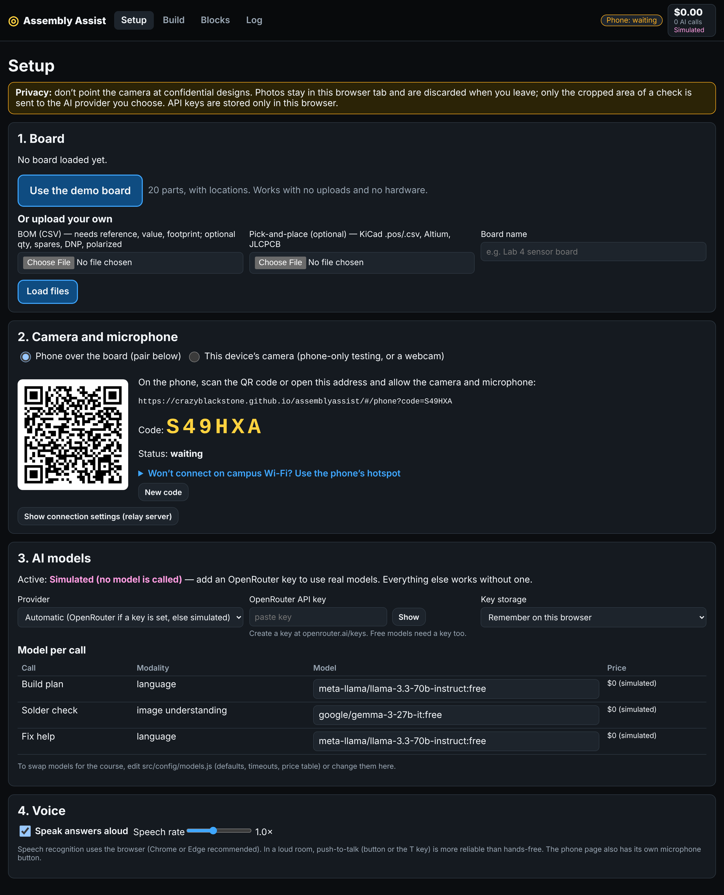

Four sections: board, camera and microphone, AI models, voice. The privacy note is at the top. With no key, the active provider is **Simulated**, so the app works without any setup.

### 2. Uploading your own BOM and pick-and-place file
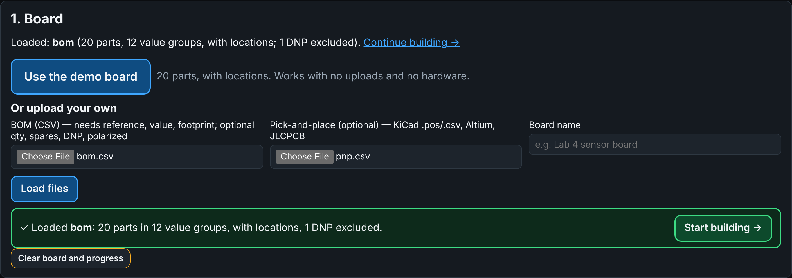

After **Load files**, a green panel confirms what was loaded (parts, value groups, locations, DNP parts excluded) and offers **Start building →**. Problems with the files appear in a red box that names the file.

### 3. Pairing the phone
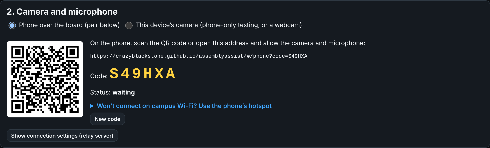

Scan the QR code with the phone or type the 6-letter code. The status changes from *waiting* to *streaming*. **Show connection settings** holds the relay-server fields for an optional EC2 TURN or PeerServer.

### 4. Hotspot help
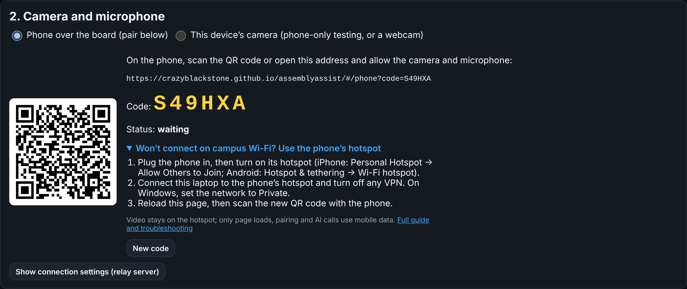

The short version of [phone-hotspot.md](phone-hotspot.md), for when campus Wi-Fi blocks the connection.

### 5. AI models and keys
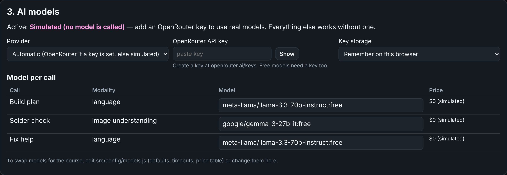

One provider layer for all three calls. Choose the provider, paste a key (stored only in this browser, optionally only for this tab), and pick a model per call. The modality and price of each call are listed.

---

## Build

### 6. Current part, polarized
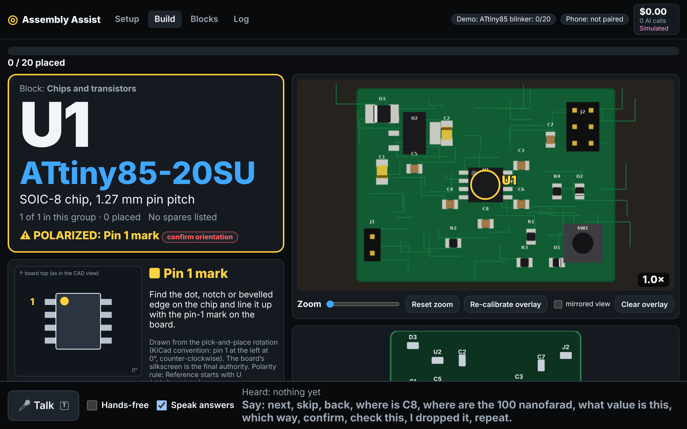

- **Part card:** large reference, value and package, readable from arm's length.
- **Polarized parts:** a yellow border, the **POLARIZED: Pin 1 mark** badge, and an orientation diagram drawn from the footprint and pick-and-place rotation. **Placed** stays disabled until the orientation is confirmed.
- **Live view:** digital zoom, and a ring on the current part once the overlay is calibrated with two taps.
- **Board map:** drawn from the pick-and-place file.

### 7. Voice: "where is C8?"
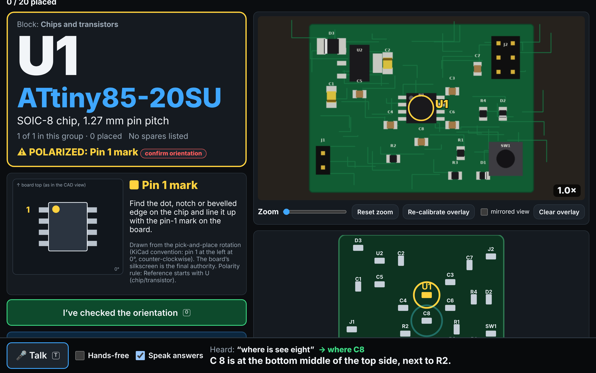

The voice bar always shows what was heard (*"where is see eight"*) and how it was understood (*→ where C8*), so a misheard command is visible. The answer comes from the board data: it's spoken, shown on screen, and C8 is ringed on the board map.

### 8. Solder check: crop
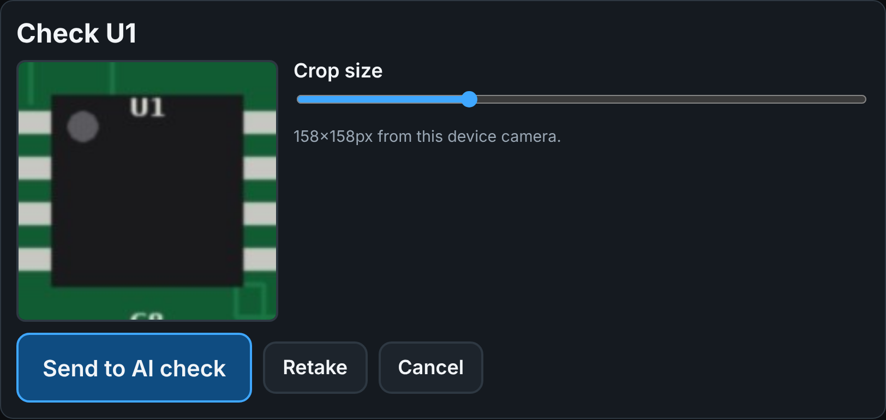

After **Check this part**, the user taps the part on the live view. The app takes a full-resolution still, crops around the tap and shows exactly what will be sent; the whole board is never sent. A local brightness and blur check warns before any call is spent.

### 9. Solder check: AI sees no problem
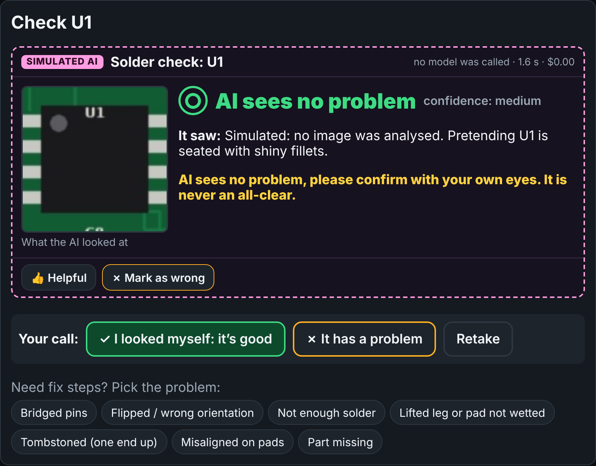

The result shows the image that was analysed, the verdict, the confidence and what the model saw. It never gives an all-clear: *"AI sees no problem, please confirm with your own eyes."* The user makes the final call with the **Your call** buttons.

### 10. Solder check: possible problem, fix help, mark as wrong
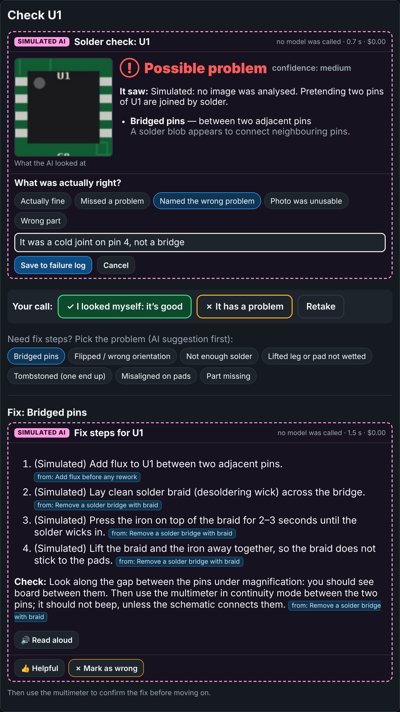

- **Flagged issue:** a specific problem (*Bridged pins*). The issue chips let the user pick a different one.
- **Fix help:** short steps for this part. Each step shows the technique-library entry it came from (*from: Remove a solder bridge with braid*), and the panel ends with a **Check** step.
- **Mark as wrong:** asks what was actually right and writes an entry to the failure log.

### 11. Solder check: can't tell
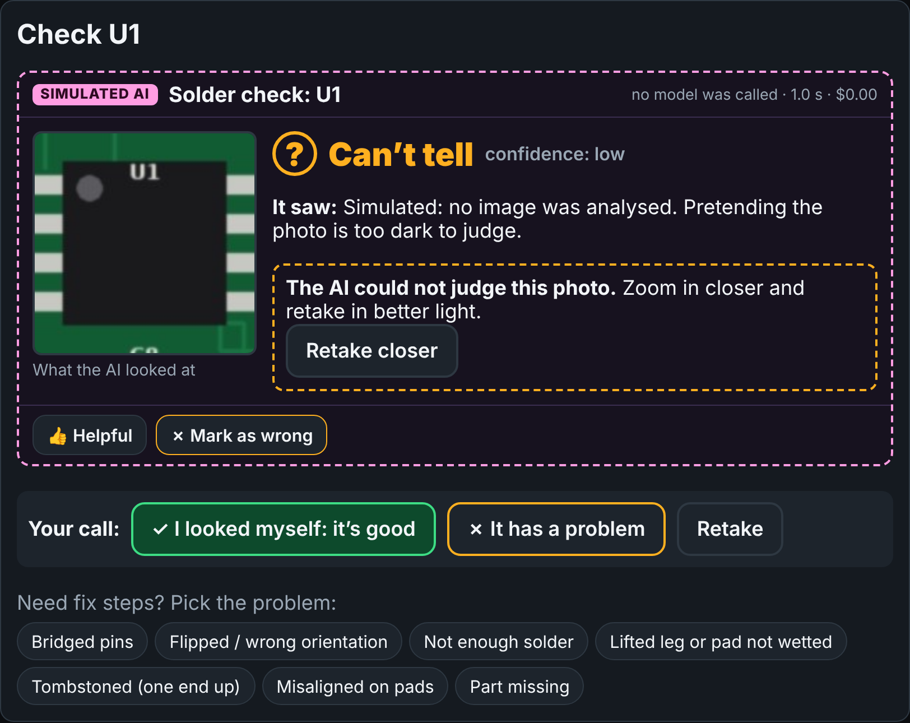

"Can't tell" is a full result, not an error. It comes with advice ("Zoom in closer and retake in better light") and a **Retake closer** button.

### 12. Block finished: multimeter checkpoint
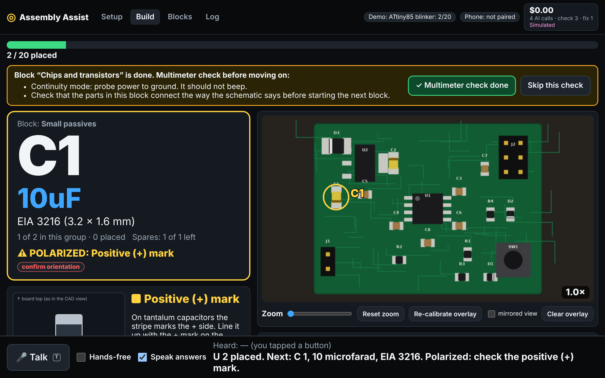

When every part in a block is handled, a banner asks for a multimeter check before moving on. The user can record it as done or skip it.

### 13. Jump to any part
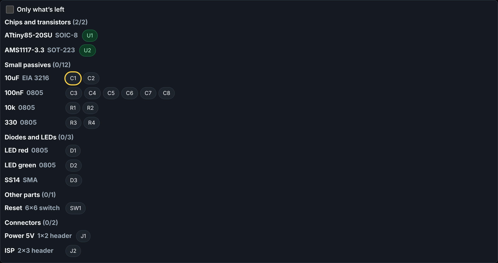

Parts are grouped by block, then by value, so identical parts sit together. Colours show placed, skipped, dropped and current parts. Tap any chip to jump to it.

### 14. Dropped part and tray compartment
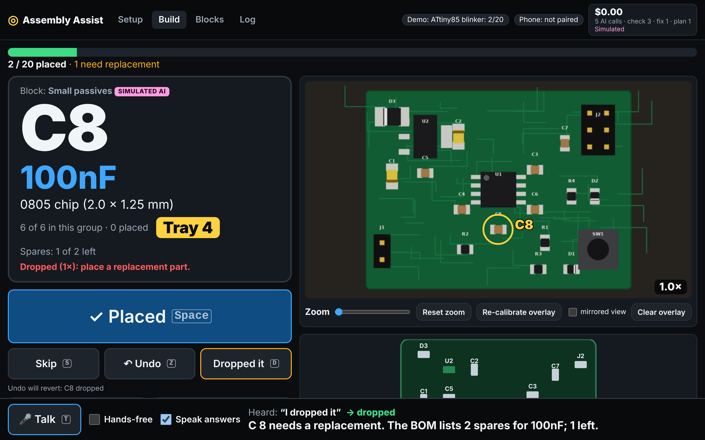

*"I dropped it"* marks C8 as needing a replacement and reports the spares the BOM lists (*2 spares for 100nF; 1 left*). The big yellow **Tray** label shows which compartment holds the part.

### 15. Laptop with the phone streaming
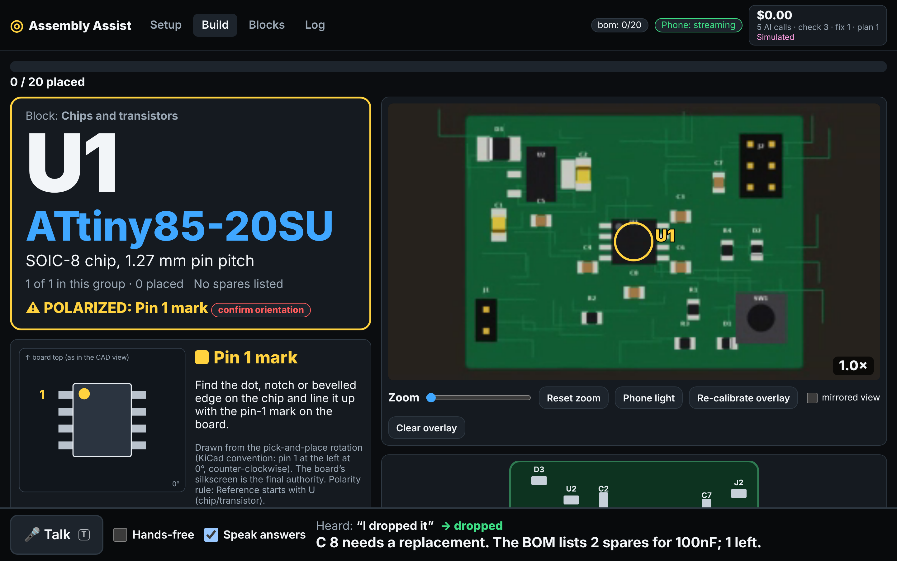

The header shows **Phone: streaming**, and the live view is the phone's camera.

---

## Blocks

### 16. AI build plan proposal
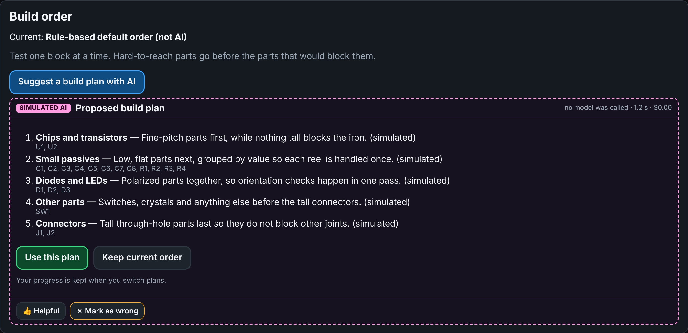

The language model proposes blocks, each with a one-line reason. The app checks the plan against the BOM before showing it: every part must appear exactly once, and any invented part is removed and logged. The user can accept it or keep the current order.

### 17. Blocks, checkpoints and tray mode
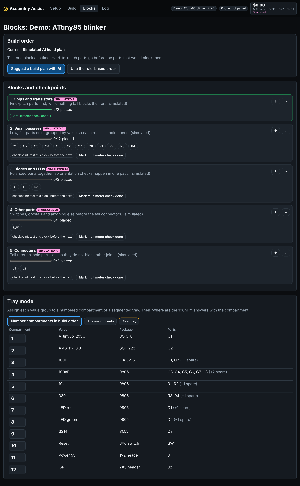

- **Blocks:** in build order, with arrows to reorder them. AI-written names and reasons carry the AI label.
- **Checkpoints:** the status of each block's multimeter check.
- **Tray mode:** numbers each value group's compartment, so *"where are the 100nF?"* answers with the compartment number.

---

## Log

### 18. Cost and failure log
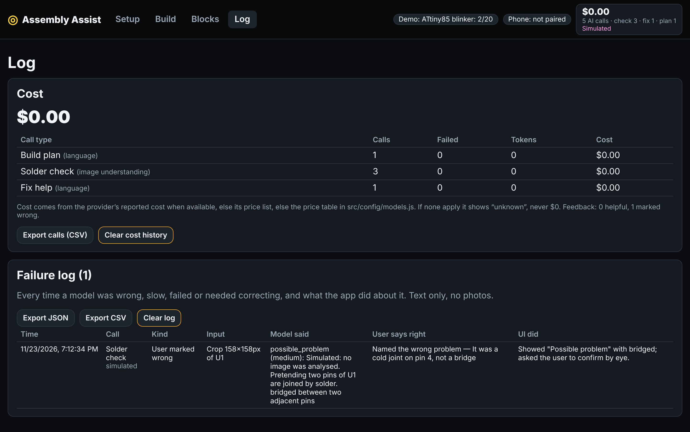

- **Cost:** a running total with calls, failures, tokens and cost for each call type. A model with no price data shows "unknown", never $0.
- **Failure log:** every time a model was wrong, slow, failed or was corrected by the app. Each entry records the input, what the model said, what the user says was right, and what the UI did. Exports to JSON or CSV for the report.

The cost meter in the header is visible on every screen.

---

## Phone

### 19. Phone: enter the code
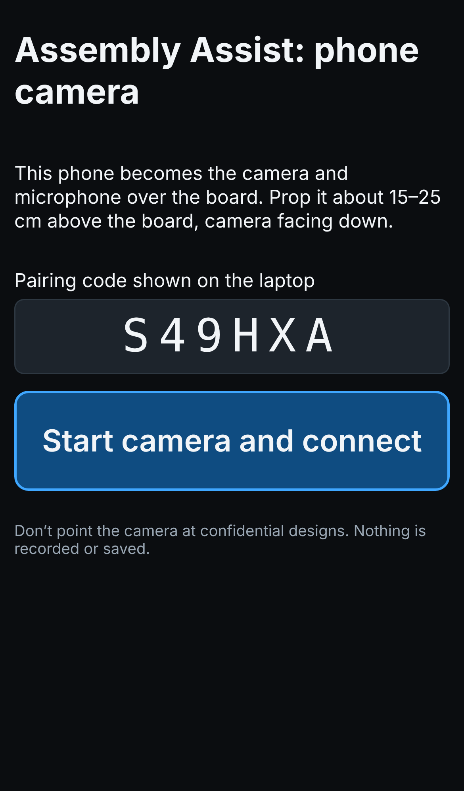

The page the QR code opens. The code is pre-filled from the link.

### 20. Phone: streaming
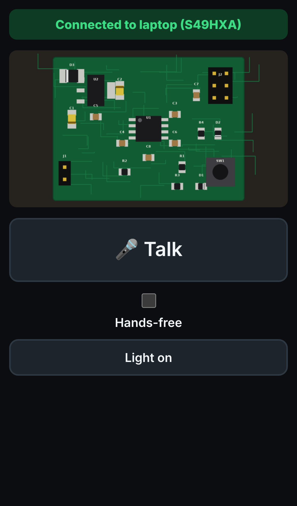

The phone shows its camera preview, a big **Talk** button, a hands-free toggle and the torch. Voice commands said here are sent to the laptop.

### 21. Phone-only mode
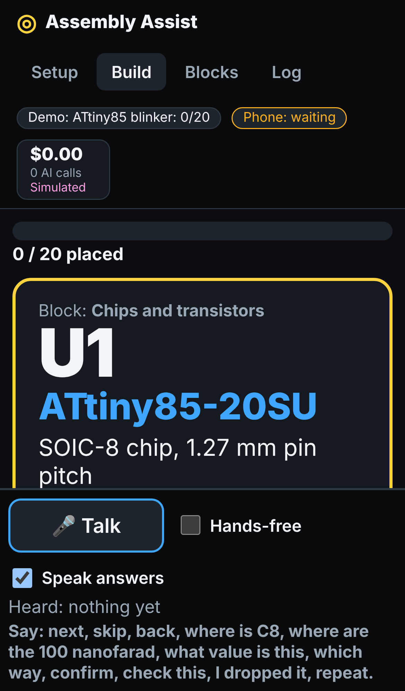

For testing without a laptop: open the site on the phone and choose **This device's camera** in Setup. The layout stacks into one column.

---

## Retaking the screenshots

The capture script and fake camera are not in the repo. The steps were:

1. Draw the demo board from `src/data/demo/demo-pnp.csv` into a 1280×720 image.
2. Convert it to a `.y4m` video with ffmpeg.
3. Launch Chromium with `--use-fake-device-for-media-stream --use-file-for-fake-video-capture=board.y4m`.
4. Replace `SpeechRecognition` with a scripted fake, then drive each screen with Playwright.

Ask Claude to add the script to `scripts/` if you want to rerun it yourselves.
