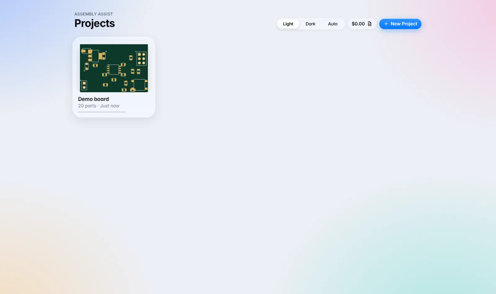
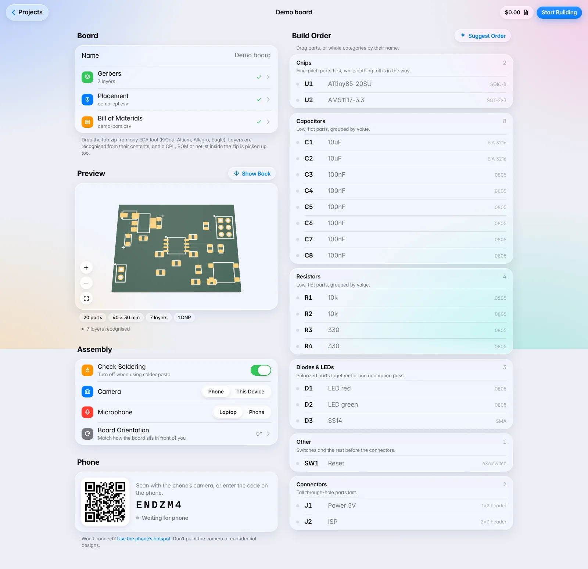
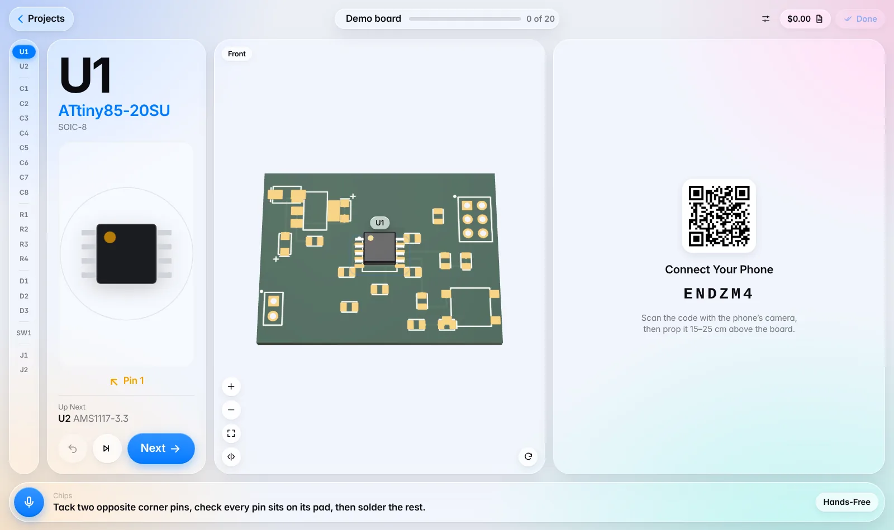
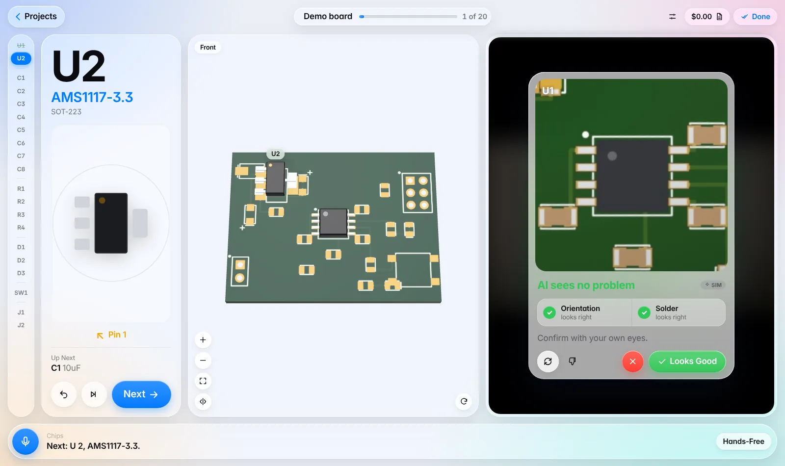
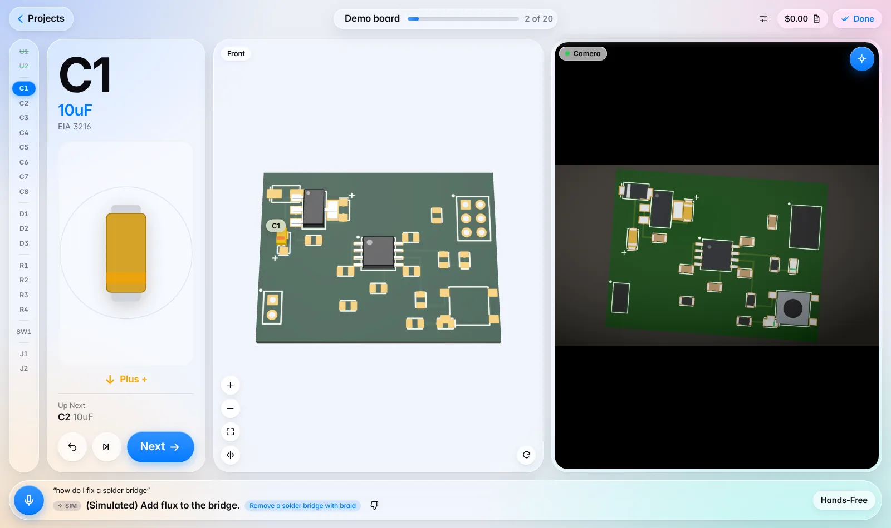
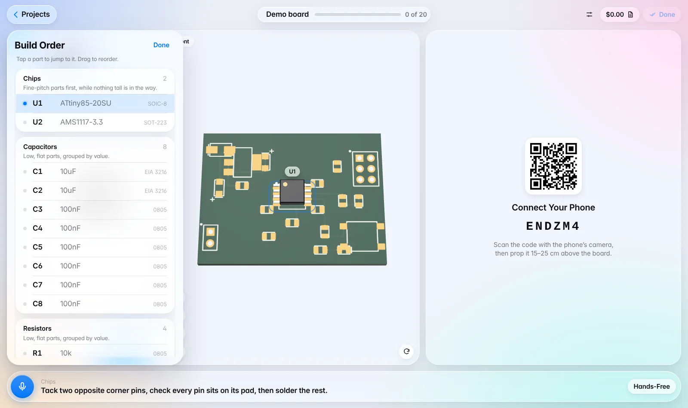
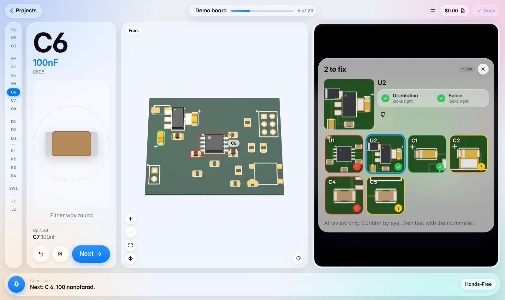
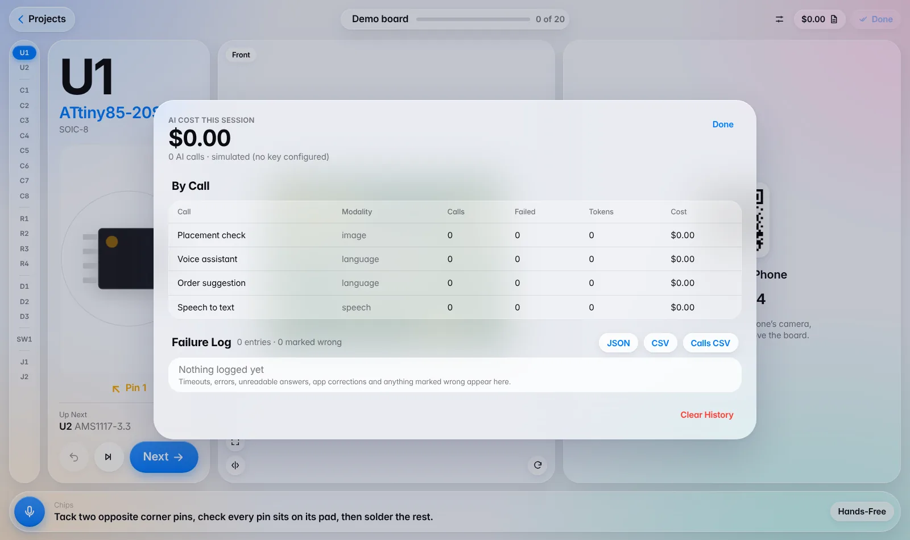
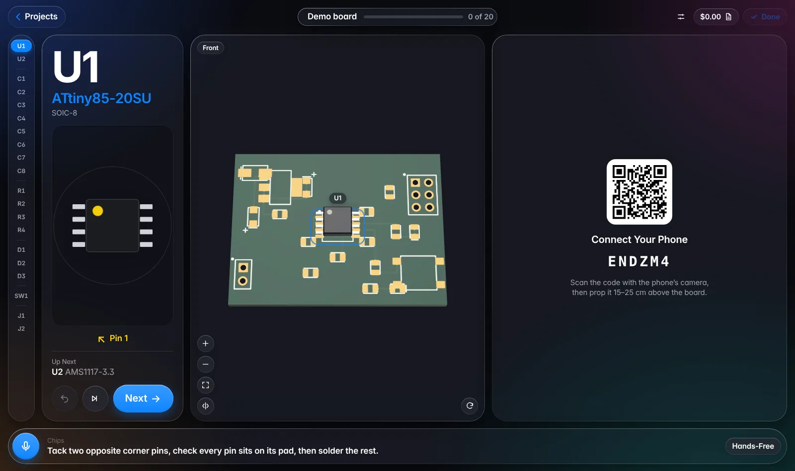
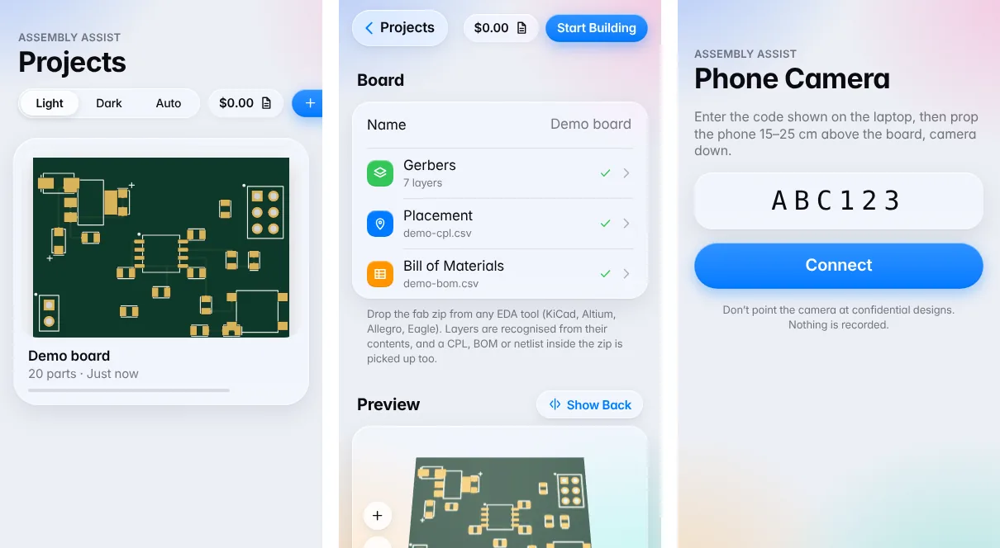

# Era 4: Liquid Glass in colour

*Screenshots from 24 Nov 2026, commit `8a68d17`. Kept as a record of this version; the app has changed since. [All eras](../../screenshots.md)*

This version was live for a short time. It moved from the dark look to a light one: translucent glass panels over a pastel colour field, blue as the accent colour, coloured setting icons and a gradient AI badge. It was replaced by Era 5, which keeps the glass and drops most of the colour.

These were captured from a local build at 1600×950 and 1× scale, so they are smaller than the other eras. The demo board is loaded and the camera is a fake. The phone wasn't paired in these shots.

## Projects

A large title, a Light / Dark / Auto switch, the cost chip and **New Project**. Each project is a glass card.

## Setup

Grouped lists: Board (name and file rows that take drops), Preview, Assembly, Phone and Build Order.

## Build

Floating glass toolbar with a progress capsule; the part, board and camera panels are glass over the colour field.

## Cost and failure log

## Dark

## Phone sizes

